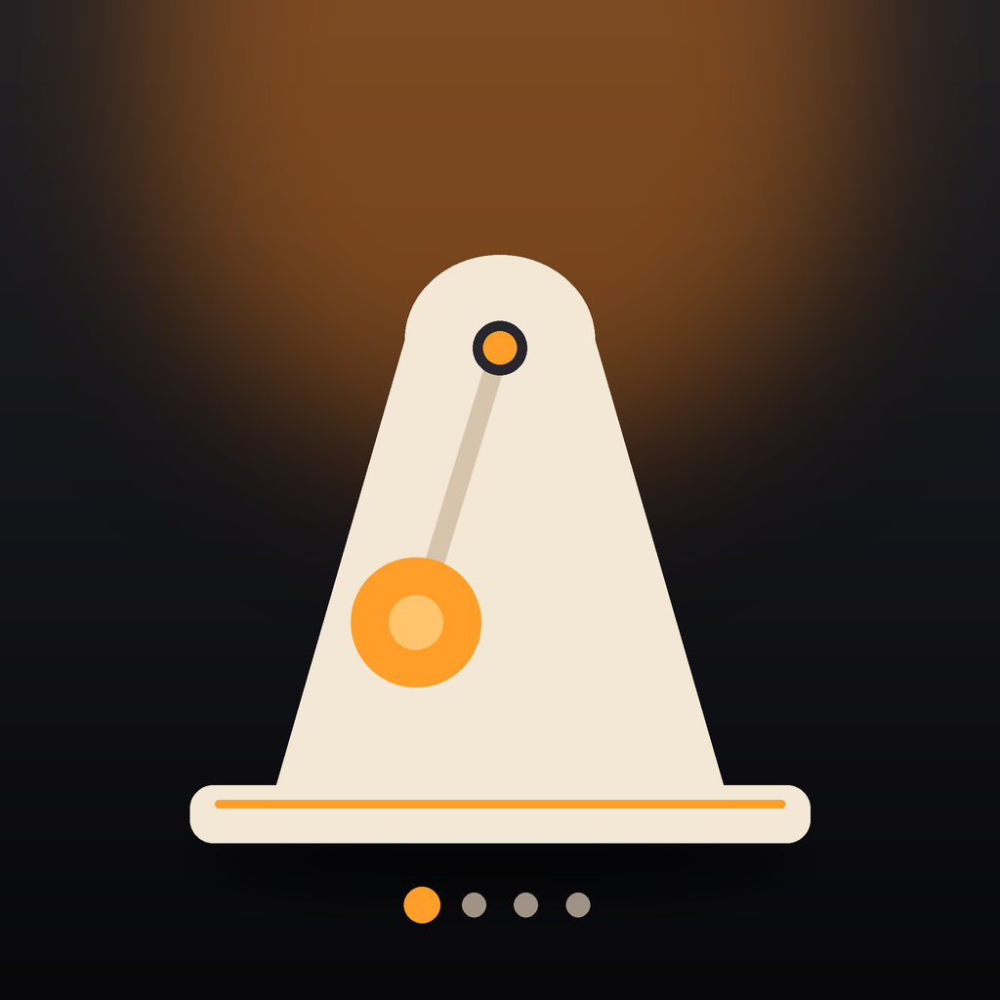
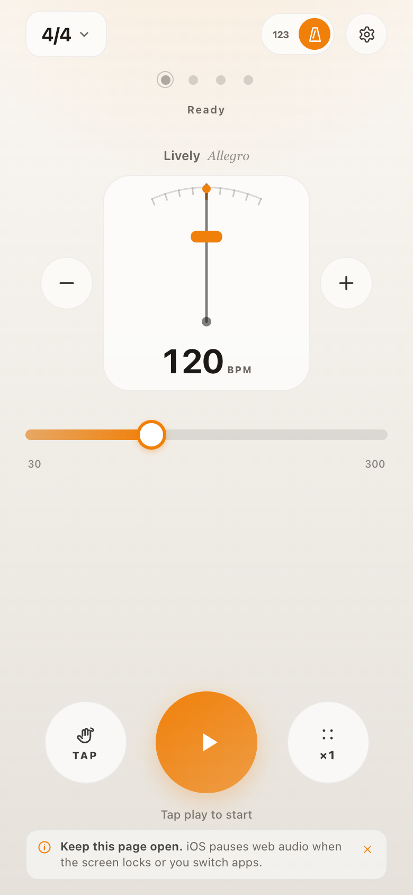
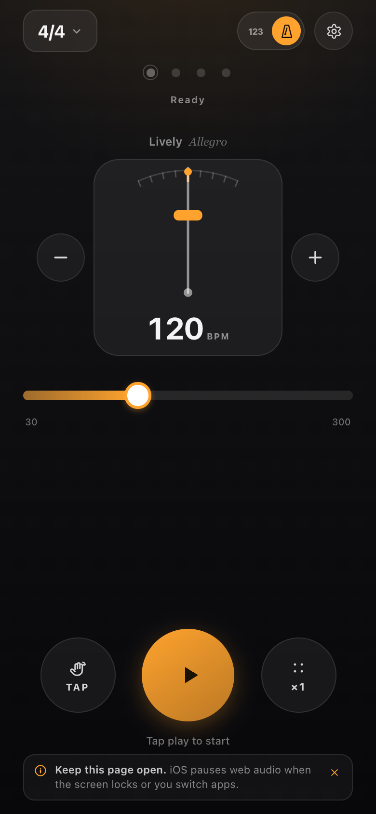
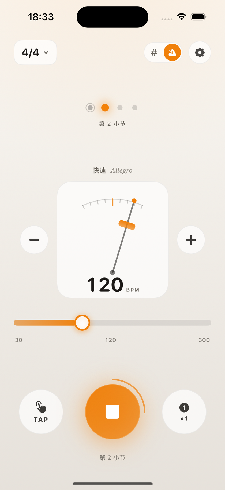
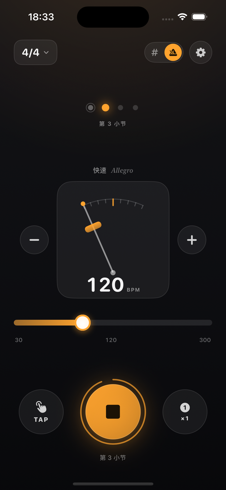
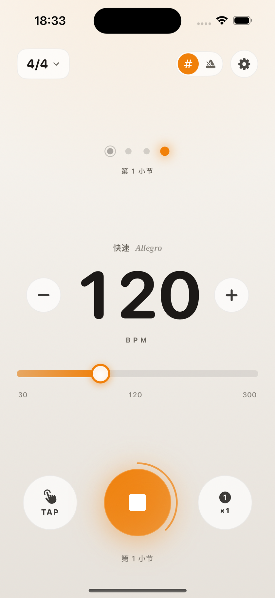

# Tempo

一个无广告、离线、专注的 iOS 节拍器。用 SwiftUI + AVAudioEngine 实现，UI 语言跟随系统（简体中文 / English）。



## Web 版（免安装）

`Web/` 里是一个可以直接在 iPhone Safari 打开的单页 PWA：同样的 30–300 BPM、拍号、细分、重拍、预备拍、Tap Tempo、4 种合成音色和深浅色界面，不需要 App Store、开发者账号或构建工具。

```bash
cd Web
python3 -m http.server 8123
```

Mac 上打开 <http://127.0.0.1:8123>；iPhone 用同一 Wi-Fi 访问 `http://<Mac 局域网 IP>:8123`。正式使用建议部署到 Cloudflare Pages / Netlify Drop 等免费 HTTPS 静态托管，再从 Safari「添加到主屏幕」。

<p align="center">
  
  
</p>

网页版最大的限制是 **iOS 锁屏或切到后台会暂停 Web Audio**，因此它适合把手机放在谱架上、屏幕保持常亮时使用。完整说明、部署步骤和限制见 [Web/README.md](Web/README.md)。

## 界面

<p align="center">
  
  
</p>

<p align="center">
  
</p>

顶部左侧是「4/4」拍号徽标，点按即可更换；右侧可以在**钟摆**和**数字**两种速度显示之间切换。

## 功能

- **速度 30–300 BPM**：数字 / 钟摆两种显示（默认钟摆，由音频时钟驱动，每拍反向摆动一次），滑杆、长按 ± 连续调整、点击测速（Tap Tempo，自动剔除偏差过大的间隔）。
- **重拍 / 弱拍**：第一拍重音，其余弱音；6/8、9/8、12/8 等复合拍自动强调每组第一个音。
- **拍号**：左上角以「4/4」拍号徽标展示，点按选择 2/4、3/4、4/4、5/4、6/8、7/8、9/8、12/8 预设，也支持 1–16 拍、2/4/8/16 分音符的自定义拍号。
- **细分**：无 / 八分 / 三连音 / 十六分，细分音更轻、更高，不抢重拍。
- **预备拍**：0–4 小节 count-in，每小节第一拍重音。
- **视觉**：节拍点、按钮外圈的进度环、重拍全屏闪光；全部由音频时钟驱动。
- **听觉**：4 种合成音色（经典 / 木鱼 / 电子哔声 / 数码），可调音量与试听；不依赖任何音频素材文件。
- **触觉**：重拍 / 弱拍可分别触发不同强度的震动。
- **后台与锁屏**：`playback` 音频会话 + `UIBackgroundModes: audio`，锁屏、静音键打开时继续走拍；锁屏 / 控制中心的播放、暂停按钮可用，并显示当前 BPM 与拍号。
- **细节**：暗色模式、保持屏幕常亮、与其他 App 音频混合、耳机拔出自动暂停、来电中断后恢复、音频服务重置后重建。
- **无广告、无网络、无追踪**：没有第三方依赖，没有分析 SDK，不申请任何网络权限。

## 核心原则：调度与发声分离

节拍器最常见的错误是用 `Timer` 直接触发声音。`Timer` 会被主线程阻塞、被系统合并，误差随运行时间累积，听感会“飘”。

Tempo 的做法：

```
┌─────────────────┐   配置（BPM/拍号/细分/音色）   ┌────────────────────┐
│  MetronomeEngine│ ───────────────────────────▶ │  ClickScheduler    │
│  @MainActor     │ ◀─── 最近点击日志（含样本时间）──│  串行队列 + 8ms 定时器│
└────────┬────────┘                              └─────────┬──────────┘
         │ 每帧读取 player 的 render sampleTime              │ scheduleBuffer(at:)
         ▼                                                  ▼
   CADisplayLink ──▶ beatPhase / pulseToken           AVAudioPlayerNode
         │                                                  │
         ▼                                                  ▼
   SwiftUI 视图（进度环、节拍点、闪光）              mainMixer ──▶ 硬件输出
```

- 定时器**只负责提前把 buffer 排进队列**，从不直接发声。前台预排 0.2s，后台预排 0.9s；即使定时器被延迟，已经排好的声音仍会在精确的采样点上播放。
- 所有 buffer 都带绝对 `AVAudioTime(sampleTime:atRate:)`，由音频硬件时钟决定发声时刻。视觉同样读取 `player.playerTime(forNodeTime:)`，所以“看到的”和“听到的”来自同一个时钟。
- 时间推进用 `Double` 记录拍位置、调度时才四舍五入到整采样，长时间运行不会累积漂移。`Tools/CoreCheck` 里用 10 分钟音频（含 137 BPM 这种不整齐的速度）验证过：累计误差 < 1 个采样。
- 变速在**下一拍**生效，细分变化在**下一拍**生效，拍号变化在**下一小节**生效，避免半拍中途改变造成听觉撕裂。
- 从后台回到前台、或设备长时间休眠后，调度器会跳过已经“过期”的拍子并重新对齐网格，而不是补放一串迟到的咔哒声。

## 工程结构

```
Tempo/
├── App/
│   └── TempoApp.swift              @main，注入 MetronomeEngine
├── Core/                           纯逻辑，无 UI/音频依赖，可单独编译测试
│   ├── TempoMath.swift             BPM 范围、拍间隔、每拍采样数
│   ├── TimeSignature.swift         拍号校验、复合拍重音、分组
│   ├── Subdivision.swift           细分枚举
│   ├── TempoMarking.swift          意大利速度术语（Grave … Prestissimo）
│   ├── TapTempo.swift              点击测速（去抖、剔除离群值、滑动窗口）
│   ├── ClickSound.swift            音色 / 重音类型
│   ├── DisplayMode.swift           数字 / 钟摆两种速度显示
│   ├── MetronomeSettings.swift     设置模型、校验、JSON 持久化
│   └── Localization.swift          %lld 占位符格式化
├── Audio/
│   ├── MetronomeEngine.swift       @Observable 门面：状态、生命周期、中断恢复
│   ├── ClickScheduler.swift        ★ 采样级调度器（串行队列，独立于 UI）
│   ├── ClickBank.swift             启动时合成 4×3 个 click buffer
│   ├── AudioSessionController.swift 音频会话与系统通知
│   └── NowPlayingController.swift  锁屏信息与远程控制
├── Views/
│   ├── MetronomeView.swift         主界面
│   ├── TimeSignatureSheet.swift    拍号面板
│   ├── SettingsSheet.swift         设置面板
│   ├── MetronomePendulum.swift     钟摆视图（音频时钟驱动的单摆）
│   └── TempoTheme.swift            配色、按钮、滑杆、节拍点、进度环、震动
└── Resources/
    ├── Assets.xcassets             AppIcon（1024×1024，无 alpha）+ AccentColor
    ├── en.lproj / zh-Hans.lproj    本地化
    └── PrivacyInfo.xcprivacy       隐私清单（无追踪，仅 UserDefaults）

Config/Info.plist                  UIBackgroundModes=audio 等显式声明
TempoTests/                        XCTest（纯逻辑 + 音频引擎集成）
Tools/CoreCheck/                   macOS 命令行验证工具
Scripts/verify-core.sh             一键编译并运行核心逻辑检查
Screenshots/                       模拟器运行截图（README 使用）
```

## 运行

要求：macOS、Xcode 16.4+、iOS 17+ 的 iPhone（iPad 兼容）。工程没有第三方依赖，也不需要 CocoaPods / SwiftPM。

1. 打开 `Tempo.xcodeproj`。
2. 选中 **Tempo** target → **Signing & Capabilities** → 选择你的 Team；必要时把 Bundle Identifier `com.sunday.tempo` 改成自己的。
3. 连接 iPhone，选择该设备，⌘R。免费 Apple ID 的签名 7 天后过期，重新运行即可。

> **模拟器运行时**：Xcode 需要至少安装一个 iOS Simulator runtime（Xcode → Settings → Components / Platforms，或 `xcodebuild -downloadPlatform iOS`）。
> 如果资源编译报 `No available simulator runtimes for platform iphonesimulator`，就是运行时还没装好。

## 验证

**纯逻辑（不需要模拟器、不需要音频设备）**

```bash
./Scripts/verify-core.sh
# Compiling core checks…
# Running core checks…
# ✓ 73 checks passed
```

覆盖 BPM 夹取、拍号校验与复合拍重音、Tap Tempo 去抖/去离群、速度术语边界、细分步数、设置编解码与损坏数据修复、10 分钟调度漂移、细分等分性、`%lld` 本地化格式。

**完整构建与测试（iOS 18.6 模拟器实测）**

```bash
xcodebuild -project Tempo.xcodeproj -scheme Tempo \
  -destination 'platform=iOS Simulator,name=iPhone 16' build

xcodebuild test -project Tempo.xcodeproj -scheme Tempo \
  -destination 'platform=iOS Simulator,name=iPhone 16'
# Executed 29 tests, with 0 failures
```

`TempoCoreTests` 覆盖纯逻辑（24 项）；`MetronomeEngineTests` 在 App 宿主里跑真实音频引擎（5 项）：启动后从音频时钟拿到第一拍、预备拍状态、运行中改速度/拍号、试听不误启动、空闲停止安全。iPhone 16（iOS 18.6）与 iPhone SE 3rd（紧凑布局）都实际启动截图检查过。

**真机编译**

```bash
xcodebuild -project Tempo.xcodeproj -target Tempo \
  -configuration Debug -sdk iphoneos -arch arm64 \
  CODE_SIGNING_ALLOWED=NO ONLY_ACTIVE_ARCH=NO build
```

> 截图 / 冒烟测试小技巧：模拟器里带 `-tempo-autostart` 启动参数会跳过点击直接开始走拍（该分支仅模拟器编译生效）。
> `xcrun simctl launch booted com.sunday.tempo -tempo-autostart`

## 精度与实现说明

| 项目 | 实现 |
| --- | --- |
| 调度精度 | buffer 排到绝对 sample time，硬件时钟发声；定时器只做 lookahead |
| 视觉同步 | `CADisplayLink` 每帧读 `playerTime(forNodeTime:)`，误差 < 1 帧 |
| 后台 | `UIBackgroundModes: audio`；lookahead 提升到 0.9s，系统合并唤醒也不断拍 |
| 变速 | 下一拍生效 |
| 拍号切换 | 下一小节生效（预备拍期间立即生效） |
| 中断 | 来电/闹钟打断时保存状态，结束后按系统建议自动恢复 |
| 耳机拔出 | 自动暂停，避免外放突然响 |
| 音频服务重置 | 重建整张音频图并恢复播放 |
| 声源 | 启动时用正弦/三角/方波 + 噪声瞬态 + 指数衰减合成，无素材文件 |

## 已知限制与路线图

- 目前没有节拍训练模式（渐快、随机静音小节、A/B 循环）。
- 没有 Apple Watch 与桌面小组件。
- 没有“音频延迟校准”界面；对耳机/外放而言当前 lookahead 足够稳定。
- 锁屏封面使用代码绘制的图形，后续可以换成设计稿。
- 后续可以加入：训练模式、更多音色、导出练习记录（纯本地）、Click 音量包络自定义。

## 隐私

Tempo 不联网、不集成任何分析或广告 SDK、不收集任何数据。设置只保存在本机 `UserDefaults`，并在 `PrivacyInfo.xcprivacy` 中声明。
