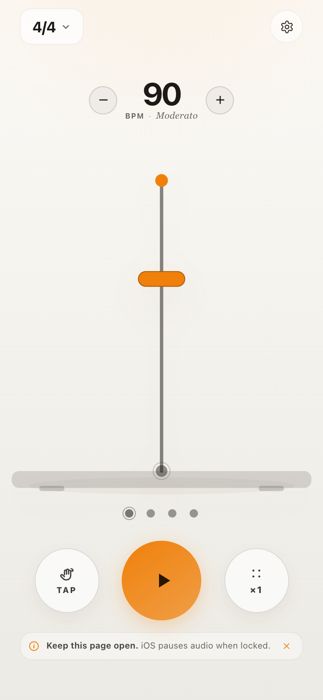
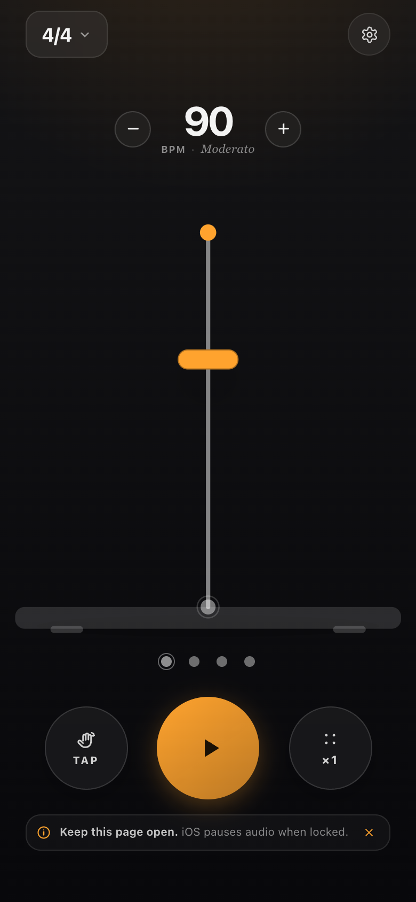
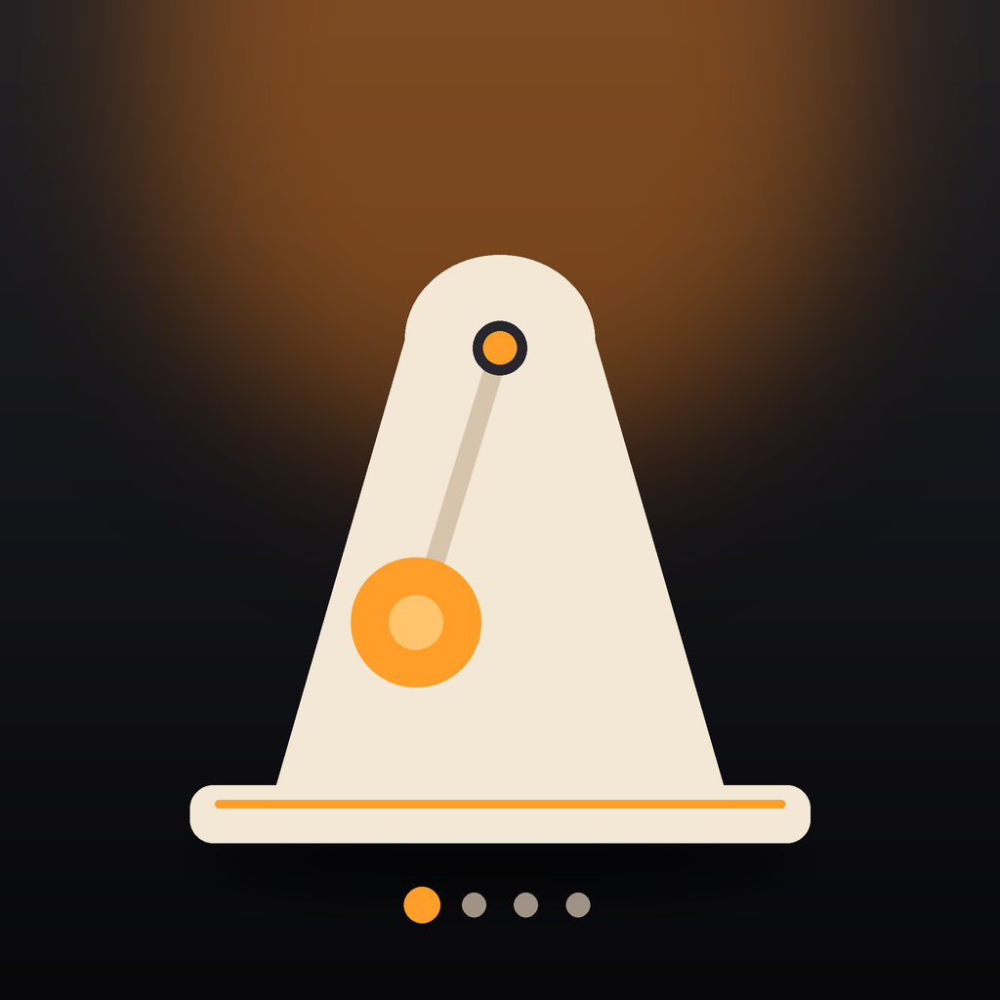

# Tempo Web

`Web/` 是 Tempo 的免安装网页版：一个单页 PWA，直接用 iPhone Safari 打开就能用。

它和原生版共用同一套交互与声音设计：放大的机械钟摆（配重块随 BPM 沿摆杆滑动）、30–300 BPM（默认 90）、拍号、细分、重拍、预备拍、Tap Tempo、8 种音色、深浅色主题。没有广告，没有账号，没有后端，也不会请求任何第三方接口。

<p align="center">
  
  
</p>



## 先看限制

网页版不是原生 App，有三个必须知道的边界：

| 限制 | 说明 |
| --- | --- |
| **锁屏 / 切后台会停** | iOS 会挂起 Safari 的 JavaScript 和 Web Audio。屏幕锁上、切到别的 App、回到桌面，节拍都会停。这是系统限制，网页无法绕过。 |
| **需要保持页面在前台** | 适合放在谱架上、屏幕常亮时使用。开始播放后，页面会尝试请求 Screen Wake Lock；系统不支持时请把「设置 → 显示与亮度 → 自动锁定」改为「永不」。 |
| **静音开关可能静音** | 如果听不到声音，先检查 iPhone 侧面的静音拨片，并确认音量不是 0。网页无法像原生 App 一样强制使用 playback 音频会话。 |

如果你需要**锁屏继续走拍、锁屏控制、耳机拔出暂停**，那仍然需要原生版。网页版解决的是“现在就想在手机上用、不想装 App / 不想折腾开发者账号”的场景。

## 本地预览

不需要安装依赖，也不需要构建。

```bash
cd Web
python3 -m http.server 8123
```

然后打开：

- Mac 本机：<http://127.0.0.1:8123>
- iPhone（同一 Wi-Fi）：`http://<Mac 的局域网 IP>:8123`

查看 Mac 局域网 IP：

```bash
ipconfig getifaddr en0
```

> 注意：通过局域网 IP 访问时，浏览器不把普通 HTTP 当作安全上下文，Service Worker 不会注册，因此**离线缓存不可用**；页面本身和音频仍能正常工作。要测试 PWA 离线能力，请用 `localhost` 或部署到 HTTPS 后再试。

## 在 iPhone 上使用

1. 用 **Safari** 打开部署后的网址。
2. 点底部 **分享** 按钮。
3. 选择 **添加到主屏幕**，名称可以改成 `Tempo`。
4. 从主屏幕图标打开。它会以全屏方式启动，布局和 Safari 里一致。

第一次打开时，页面底部会显示一次安装提示；也可以随时在「设置 → Install」里查看步骤。

## 免费部署

页面是纯静态文件，任意静态托管都可以。以下三种都免费、自动提供 HTTPS：

### Cloudflare Pages（推荐）

1. 打开 Cloudflare Dashboard → **Workers & Pages** → **Create** → **Pages** → **Upload assets**。
2. 把整个 `Web/` 文件夹拖进去。
3. 部署完成后会得到一个 `https://<project>.pages.dev` 地址。

免费额度对个人使用足够，流量不额外计费。

### Netlify Drop

1. 打开 <https://app.netlify.com/drop>。
2. 把 `Web/` 文件夹拖到页面里。
3. 得到 `https://<random>.netlify.app` 地址。

免费额度约 100 GB/月，个人节拍器远远用不到。

### GitHub Pages

1. 新建一个 **public** 仓库（免费账号的 Pages 需要公开仓库）。
2. 把 `Web/` 里的文件放到仓库根目录，或把 `Web/` 作为 Pages 发布目录。
3. Settings → Pages → Source 选择分支和目录，保存。
4. 地址是 `https://<用户名>.github.io/<仓库名>/`。

本项目的所有资源都使用相对路径（`./`），放在子路径下也能正常工作。

自定义域名是可选的，不买也能用上面的免费域名。域名本身通常每年几十元，HTTPS 证书由托管平台自动签发。

## 音质与调度实现

- 默认的 **Classroom** 来自你提供的《怀旧节拍器音效-音乐课堂教材音效-经典音乐室场景》（爱给网 aigei.com）：只截取单次重拍 / 正拍的干声，去掉原录音里较重的房间噪声；再用一个很轻的干净房间混响把两拍连起来。播放时按当前 BPM 重新调度，不使用原文件 120 BPM 的固定节奏。它走独立的无压缩通道，不经过合成音色的 1.6× 增益和 compressor。
- 其余音色在启动时用 Web Audio 合成：正弦 / 三角 / 方波 + 噪声瞬态 + 指数衰减。
- 调度器使用 `AudioContext.currentTime` 做 120 ms lookahead，`setInterval(25ms)` 只负责“把下一批 click 排进音频时钟”，因此主线程抖动不会让节拍累积漂移。
- 钟摆角度 / 节拍点 / 进度环都从同一份音频时钟读取，视觉和声音对齐。
- 变速在下一拍生效；拍号、细分、重音设置在下一拍 / 下一小节生效。
- 设置保存在浏览器 `localStorage`，刷新、从主屏幕重开都会保留。

## 文件

| 文件 | 作用 |
| --- | --- |
| `index.html` | 全部 UI、CSS、Web Audio 引擎、设置与交互 |
| `audio/` | Classroom 的单次重拍 / 正拍 WAV 采样 |
| `manifest.webmanifest` | PWA 名称、图标、启动方式 |
| `sw.js` | 离线缓存；首次在线打开后，断网也能重新加载 |
| `icons/` | 从原生 App 图标生成的 180 / 192 / 512 / 1024 PNG |

## 更新与排错

- **改了文件但 iPhone 还看到旧版**：Service Worker 会优先返回缓存。把 `sw.js` 里的 `CACHE_VERSION` 递增（当前是 `tempo-web-v26`，下一次改成 `tempo-web-v27`），重新部署，再关闭 / 重开主屏幕图标。
- **点播放没有声音**：确认不是静音拨片、系统音量不是 0；先点一下页面任意按钮再点播放（iOS 要求用户手势后才能启动音频）；如果之前接过来电或耳机，刷新页面重试。
- **屏幕自动变暗**：Safari 不支持 Wake Lock 时，网页无法阻止自动锁定。把自动锁定设为「永不」，或使用原生版。
- **离线打不开**：Service Worker 只在 HTTPS 或 `localhost` 下工作；通过局域网 IP 的 HTTP 地址访问不会缓存。
- **添加到主屏幕后仍是 Safari 界面**：确认是从 Safari 的分享菜单添加，而不是从其他浏览器；iOS 上只有 Safari 能安装 PWA。

## 不做的事

网页版不会请求麦克风、定位、通知或任何网络接口；没有统计、广告、第三方字体和 CDN。它只做一件事：在你把页面留在前台时，稳定地打拍子。
